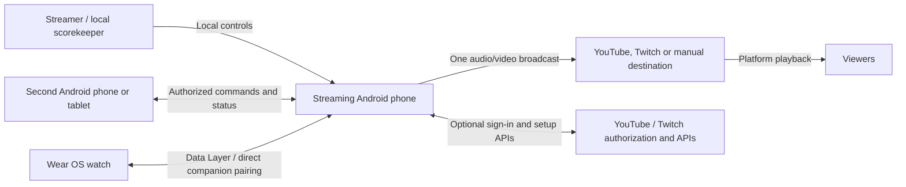
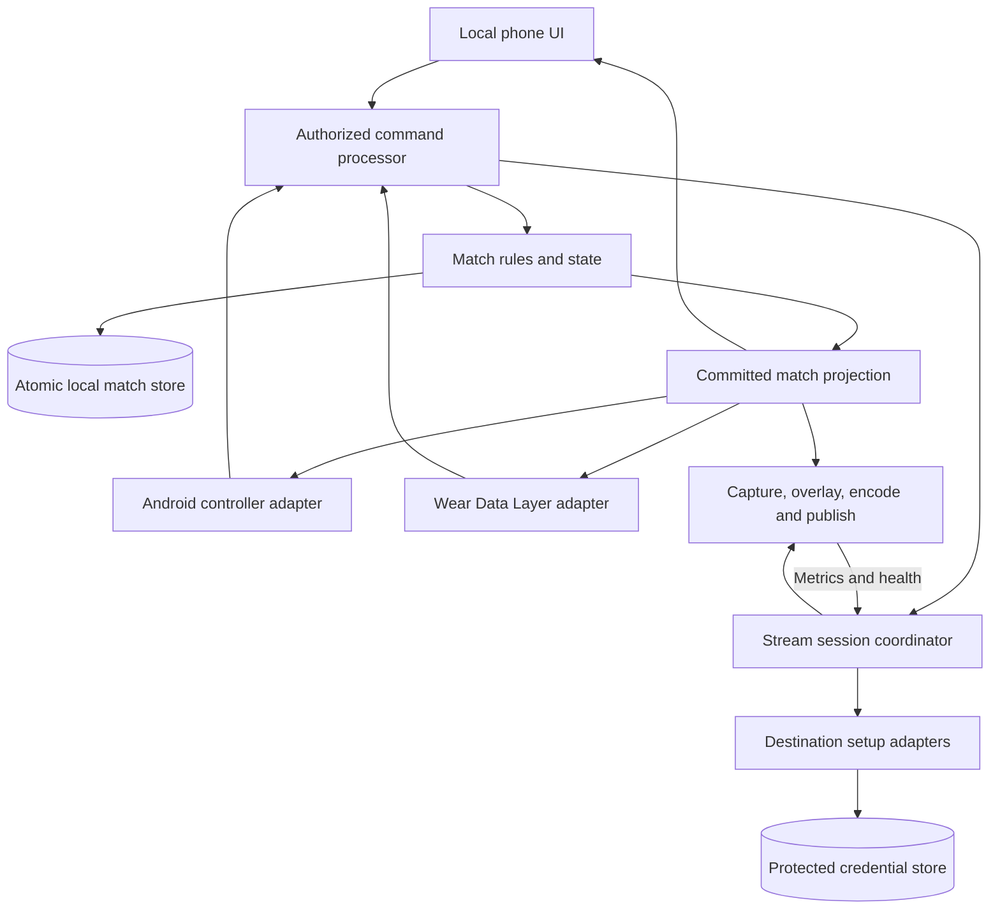
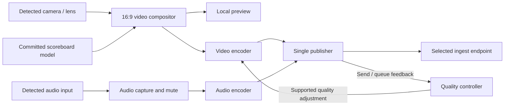
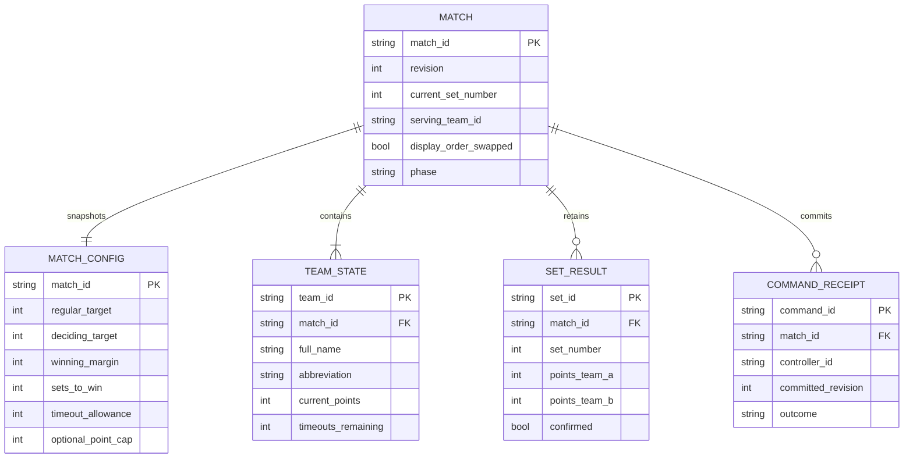
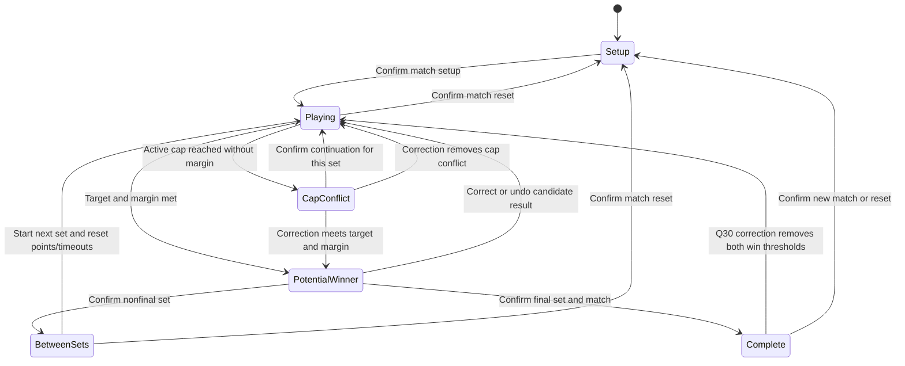
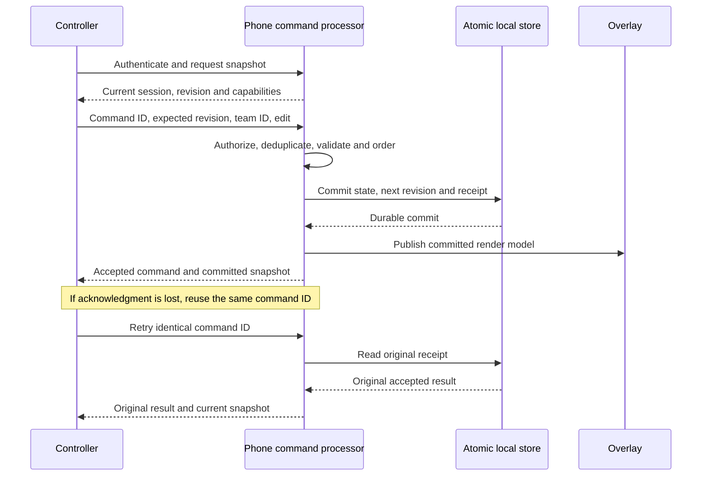
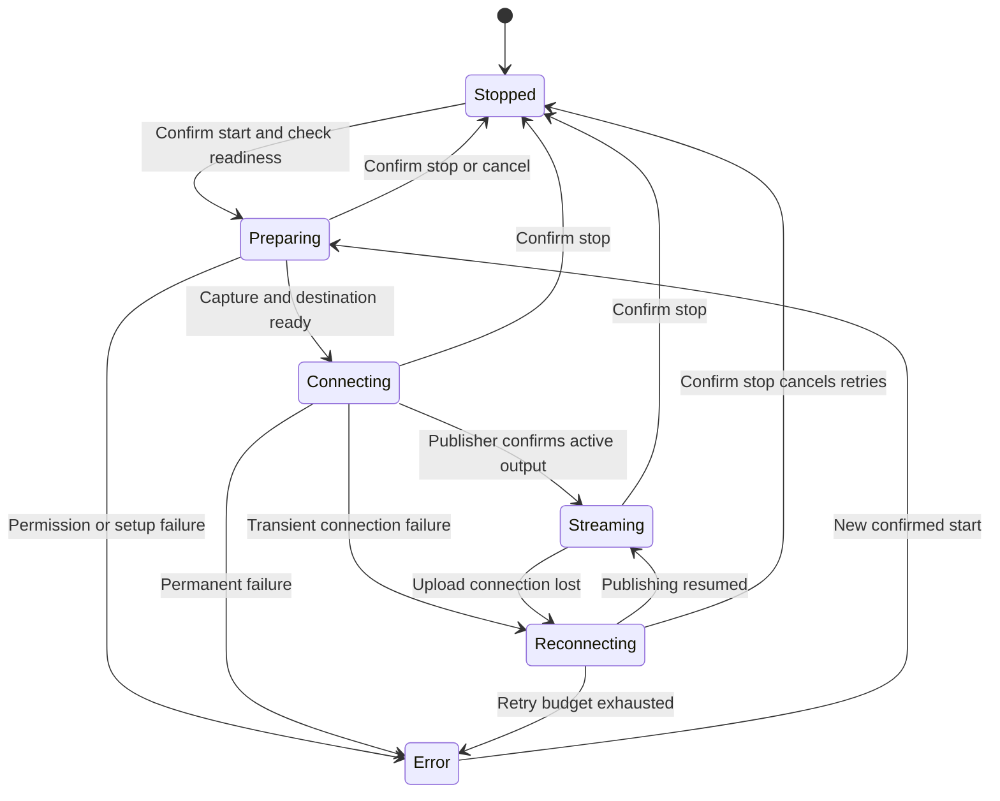

# LiveStream Software Architecture

Status: Proposed application architecture; authorized isolated M2 probes in progress  
Created: 2026-10-17  
Requirements authority: [Approved PRD](PRD.md), 2026-10-17  
Delivery and acceptance mapping: [Master Plan](plan/MASTER_PLAN.md)

## 1. Scope and architectural intent

Design a manageable Android application that owns one volleyball broadcast and
its match state on a streaming phone. A second Android device and a directly
paired Wear OS watch act as authorized controllers. The phone composites the
scoreboard into captured video and publishes audio/video to one destination.

The PRD's Android/Wear OS platforms, direct watch pairing through Data Layer
(Q7), control matrix, and indoor scoring defaults are confirmed. Component
boundaries, contracts, persistence mechanics, and policy recommendations in
this document are **proposals**. Language, UI, SDK levels, media library,
second-phone transport, and storage remain TBD. This document authorizes no
scaffold, application dependencies, prototypes, or application tests.

The later owner request on 2026-10-23 opens G1 for M2 feasibility/harness work
and Q47 confirms T01–T06. The [M2 execution record](plan/reviews/m2-readiness-and-execution.md)
links research for all eight tasks and eight observed T01/T02 red/green cycles,
including real host SQLite file reopen/retry, one abrupt before-commit
child-JVM interruption fixture and concurrent distinct commands through a
shared store instance.
An additional simultaneous duplicate-delivery test passes on its first run
with the existing implementation. The later [ST05 experiment](plan/evidence/m2/st05-reset-isolation.md)
adds durable reset generations, old-command rejection and scoped receipts;
canceled reset and before-commit reset interruption also pass.
[ST03 post-commit interruption](plan/evidence/m2/st03-lost-acknowledgment.md)
passes on its first run with unchanged store logic: retries recover the
unacknowledged receipt without applying another point or replacing newer state.
The current local suite has twelve tests. Its file-local epoch is a probe choice; final application
identity, retention, migration and device recovery remain unresolved.
The [decision ledger](plan/specifications/m2-7-stack-and-decision-dispositions.md)
distinguishes working JVM tools from proposed application technologies.
In the 2026-10-23 record physical devices were unavailable and provider settings
unknown; the application architecture and G2 remain unapproved/unverified where recorded.

Update 2026-10-24: devices are now owner-reported available but not connected
to the workstation. Q48 changes version 1 to built-in audio and defers external
microphone support and testing until after version 1. Later accessory proposals
in this document are post-v1; built-in audio and other physical checks remain required.

Proposed design priorities:

1. Preserve accepted match edits independently of stream or controller failure.
2. Give local, Android-remote, and watch commands one authoritative order.
3. Render the same accepted match values in every display and the outgoing video.
4. Separate provider/account setup from capture and publishing.
5. Use measured capabilities and feedback for media control and quality changes.
6. Keep destination secrets on the streaming phone and avoid a required custom
   account/backend unless provider feasibility forces a new decision.

## 2. System context and device topology

### Diagram: system context

[SVG](docs/diagrams/rendered/system-context.svg) ·
[Mermaid source](docs/diagrams/source/system-context.mmd)

- **Streaming phone:** Pixel 8 Pro, Pixel 10, or Pixel 10 Pro. Roles are
  interchangeable and chosen per session; actual installed OS/builds remain
  unknown in the [M1.2 inventory](plan/inventories/m1-2-device-roles-and-os-inventory.md).
  Owns match data, media, provider credentials, controller authorization, and
  stream state.
- **Second Android device:** nearby controller; transport TBD. No outgoing
  video pipeline or destination credentials are needed on this device.
- **Pixel Watch 4:** paired to the streaming phone, not a proposed relay through
  the second phone. Data Layer is confirmed; UI framework and physical behavior
  remain to be validated. Android documents matching package names and signing
  identities, and that Data Layer may use Bluetooth or Google infrastructure.
  Direct companion pairing does not promise a Bluetooth-only route.
  [Wear OS Data Layer](https://developer.android.com/training/wearables/data/overview).
  The owner reports four physical watches: one paired with each of two regular
  Pixel 10 and two Pixel 10 Pro phones. Main testing uses one Pro, its paired
  watch, and the Pixel 8 Pro; any device in the inventory may be tested.
  If Pixel 8 Pro streams with watch controls, a selected watch must
  first be paired directly to it; the companion used is recorded per session.
- **Destination services:** external authorization, APIs, ingest, and viewer
  playback. Their account restrictions, outages, and playback latency are
  outside the local command processor's control.

Prefer an Android installation that offers streaming and controller roles,
plus a Wear app sharing the necessary logical contracts. Packaging and build
modules are undecided. The diagrams show responsibilities, not a prescribed
Gradle structure or distributed services.

## 3. Logical components and boundaries

### Diagram: phone responsibilities

[SVG](docs/diagrams/rendered/phone-components.svg) ·
[Mermaid source](docs/diagrams/source/phone-components.mmd)

| Responsibility | Owns | Boundary / reason |
| --- | --- | --- |
| Local UI and controller UIs | User intent, confirmations, displayed snapshots, connection state | Never calculate a separate authoritative score or infer that a pending action succeeded. |
| Controller adapters | Pairing/session authentication, transport, schema validation, status delivery | Translate transport messages into the same command contract; never access provider secrets. |
| Authorized command processor | Capability checks, serialized order, command IDs, revisions, receipts, command expiry | Local and remote edits share ordering; stream operations have distinct acceptance/completion results. |
| Match rules/state | Per-match config, teams, points, history, serve, timeouts, display order, confirmation rules | Independent of camera/network/UI so media failures cannot reset scoring. |
| Local match repository | Atomic accepted state, revision, command receipt, undo recovery data | Commit before publishing an accepted match change; storage mechanism TBD. |
| Match projection | Sanitized snapshot for UI/controllers and overlay render model | Same committed revision, separate presentation for large phone and small watch. |
| Session coordinator | Capture readiness, chosen destination, stream lifecycle, confirmed intent, retry/quality policies | Does not treat account sign-in, a command receipt, or a camera preview as proof of live publishing. |
| Media adapters | Capabilities, camera, audio route, compositor, encoders, publisher and metrics | Hide library details behind a small boundary; no independent match ownership. |
| Destination setup adapters | Manual input, provider authorization, account/broadcast selection, ingest setup | Produce a phone-only publishing configuration; YouTube/Twitch workflows remain distinct. |
| Credential storage | Keys/tokens, protected references, disconnect cleanup | Separate from match snapshots, controller protocol, diagnostics, and ordinary settings. |

Use a single owner for mutable match state and bounded asynchronous media work.
Persistence and network calls must not block frame production. Persist only
state/commands/status as appropriate; there is no local video recording feature.

## 4. Capture, composition, encoding, and quality

### Diagram: media data path

[SVG](docs/diagrams/rendered/media-pipeline.svg) ·
[Mermaid source](docs/diagrams/source/media-pipeline.mmd)

The scoreboard is composited **before video encoding**, so destination viewers
receive it as part of the picture. Preview and output use the same committed
match values; exact preview-surface integration depends on the selected pipeline.
Camera capture and overlay stay landscape 16:9. Scaling/cropping, aspect-ratio
handling, safe area, and abbreviation limits are resolved in D03/D10.

Use the 720p/30 fps PRD baseline for stable-upload acceptance. Higher resolution
is not a confirmed release requirement. Evaluate GPU/surface composition and
hardware encoding to avoid unnecessary full-frame CPU copies. A streaming
library must support the actual compositor, camera switching, audio routes,
timestamps, lifecycle, feedback, and quality-control needs before selection.

Android exposes logical/physical camera behavior that varies by device and
implementation; enumerate capabilities and test switches rather than mapping
marketing lens names to guaranteed IDs.
[Android multi-camera](https://developer.android.com/media/camera/camera2/multi-camera).
Audio input selection is also verified from the actual active route: a preferred
device request does not guarantee it is used. Preserve intentional mute during
fallback and show permission/route failures.
[AudioRecord routing](https://developer.android.com/reference/android/media/AudioRecord#setPreferredDevice(android.media.AudioDeviceInfo)).

The proposed quality policy is bitrate-first: use publisher send/queue signals,
dropped frames, and device health to lower quality, then recover conservatively
with a stable observation window. Android exposes a dynamic video-bitrate
parameter, but that does not prove a particular encoder or library will apply
it as required. Validate the chosen implementation; resolution/frame-rate
changes may need reconfiguration or reconnect and must not be promised seamless.
[MediaCodec bitrate control](https://developer.android.com/reference/android/media/MediaCodec#PARAMETER_KEY_VIDEO_BITRATE).

The owner confirmed mobile data as the default broadcast connection on
2026-10-18 because venues change; Wi-Fi remains supported. The
[M1.4 inventory](plan/inventories/m1-4-venue-upload-baseline.md) retains the answer
and explicit measurement gaps. Honor that default in the eventual connection
design; routing when Wi-Fi is also connected and handoff/fallback mechanisms
remain D07 work. No numeric quality parameter follows from the default.

| D07 parameter | Value / policy status | Required validation |
| --- | --- | --- |
| Minimum, initial, maximum video bitrate | TBD from uplink/device/provider evidence | Congestion reduction preserves legible overlay and state. |
| Supported resolutions and frame rates | 720p/30 stable baseline; adaptive range TBD | Encoder and destination accept every selected mode. |
| Observation windows and downgrade trigger | TBD; proposed sustained queue/send pressure | Controlled restrictions over Wi-Fi and mobile data. |
| Recovery threshold and cooldown | TBD; proposed hysteresis to avoid oscillation | Recovery avoids repeated mode changes. |
| Lowest sustainable quality / outage behavior | TBD; show reconnecting/error when publishing fails | No false live status; match continues locally. |
| Retry count/backoff and maximum reconnect window | TBD; bounded, cancelable retries proposed | Stop cancels retry; stale start does not revive the stream. |
| Wi-Fi/mobile handoff | TBD after measurement | Document any reconnect/gap; preserve match and intentional mute. |
| Thermal response | TBD for selected OS/device | Full-match run, dimmed display, safe failure and retained match. |

## 5. Match model and scoring invariants

### Diagram: conceptual match model

[SVG](docs/diagrams/rendered/match-model.svg) ·
[Mermaid source](docs/diagrams/source/match-model.mmd)

This is a conceptual model, not a selected relational schema. Each match has
exactly two teams despite the diagram's general one-to-many notation. The match
store also needs baseline starting set totals/history, command expiry/session
metadata, and undo information; the diagram shows only the central fields.
Sets won are derived from confirmed history plus any explicit starting baseline,
or stored only with consistency checks. Default configurations are copied into
each match so later preset edits cannot change an active match.

Required invariants and proposed correction semantics:

- Team identity is stable. Side swaps change display order only; commands target
  team IDs rather than mutable left/right positions. A controller translates
  the displayed side into a team ID using the snapshot the user acted on.
- Indoor defaults are regular sets to 25, deciding set to 15, win by 2, no cap,
  3 sets to win (or 2 for best-of-3), and 2 timeouts/team/set. Targets, margin,
  cap, and timeout allowance are customizable. Reject invalid combinations;
  the cap never overrides the configured margin. The owner confirmed on
  2026-10-20 that 30–29 at target 25/margin 2/cap 30 is not a potential winner
  and requires explicit conflict resolution. Confirmed Q25 permits scoring
  beyond the cap only after "continue win by two" confirmation for that set;
  later sets keep their configured cap. Q29 requires cap at least target and
  explicit prior-continuation acknowledgement for tied-at-cap or above-cap
  starting/restored input; a first cap-reaching one-point lead restores as paused
  conflict. Totals-only starting baselines are allowed;
  never invent earlier scores/order. Q31 permits replacing a baseline with
  complete valid early history that matches its totals, counting each set once.
  Q32 permits reviewed phone/tablet starting-total corrections after later play
  only when the resulting sequence remains valid; preserve recorded later play.
  The [baseline/history review](plan/specifications/d11-baseline-history-policy-review.md)
  records both confirmed policies and B01–B12; revision, storage, and atomic
  validation/commit mechanisms remain open.
- A rally point gives serve possession to its winner; if the serving team won,
  possession stays unchanged. Manual serve override remains available.
  Q33 requires each fresh set to start without a selected server and blocks
  ordinary rally input until explicit selection through an authorized serve
  control. Restoring an ongoing set preserves its recorded server.
- Point subtraction is a correction and cannot infer the previous server.
  Owner-confirmed behavior: leave serve unchanged; Undo restores recorded prior
  state, including score and serve. One-step Undo for the latest accepted match
  edit persists across restart. Under Q26 it includes points, serve, timeouts,
  names/codes, display swaps, starting-value corrections, set/match confirmation,
  valid historical corrections, and current-set cap-continuation confirmation;
  success consumes the opportunity until a new accepted match edit. Stream/account
  actions and confirmed reset are excluded.
- Points/timeouts never become negative; timeouts cannot exceed that match's
  configured allowance. Restore full timeouts for a new set or confirmed reset;
  final match confirmation retains its final state.
- Detect a possible winner from the current configuration, but require
  confirmation before advancing or ending the match. Retain final-set points;
  there is no empty extra set after match completion. The owner confirmed that
  ordinary rally scoring pauses at a potential winner until confirmation or
  correction; score corrections remain available.
- Record completed-set scores and recompute related totals after corrections.
  Historical changes must not silently delete later sets or leave an impossible
  match sequence. The owner confirmed rejection of corrections that make later
  play inconsistent; preserve recorded play and require a coherent reviewed
  correction. Q30–Q32 require phone/tablet review of coherent corrections;
  no deletion of later play is authorized. Revision and atomic-commit
  mechanisms remain D11 technical work.
- Undo is proposed as a new revision referring to the latest undoable match
  mutation; it does not rewind the revision counter or undo stream/account
  operations. With multiple controllers, show what will be undone and reject
  an Undo based on a stale revision. Q26 confirms scope and no repeated Undo/Redo
  until another accepted match edit. Q27 permits watch Undo of the latest
  phone/watch point, serve, timeout, display-swap, or set-confirmation edit;
  it directs names/history and other restricted latest edits to a phone without
  skipping them. Storage and duplicate-receipt retention remain open.
- Court-side changes preserve all team data. Indoor between-set/deciding-set
  side-change rules inform the operator; no new automatic reminder feature or
  automatic display-order change is assumed.

The [volleyball-rules skill](.agents/skills/volleyball-rules/SKILL.md) supplies
domain guidance. The PRD overrides skill examples: timeouts follow customized
allowances, watch controls follow PRD 2.4, and final-set handling retains the
completed match. Overlay placement uses owner-confirmed four-corner/bottom-center
presets, editable 1–5-character validated codes, and numeric remaining `T/O`
counts. Q37–Q39 select top-left without a saved preference, per-streaming-phone
retention across matches/restarts/reset, and phone/tablet placement changes before
or during a live stream; the watch cannot change placement. Q40 keeps placement
outside match Undo, preserving its existing opportunity and the current position
when match Undo is used. Exact proportional margins, contrast, and minimum text
size remain D10 work. Preference storage/revision contracts are unselected.

The [abbreviation-validation review](plan/specifications/d10-abbreviation-validation-policy-review.md)
records Q41/Q42 and AV01–AV11: trim outside spaces, show a–z as A–Z before
saving, and accept only 1–5 uppercase A–Z/digit characters. Reject unsupported
input without truncation or transliteration. Matching codes are allowed after
a warning and explicit confirmation, with stable team identities retaining
their separate data. Code edits remain phone/tablet-only Q26 match edits;
duplicate review/confirmation creates no extra Undo steps. Q43 and RC01–RC08
preserve a saved match with nonconforming codes and keep scoring/corrections
usable, but require phone/tablet code correction before any local/remote/watch
broadcast-start request succeeds. Never silently rewrite those saved codes or
start publishing on restoration. Technical recovery/freshness/storage contracts
remain open; this adds no import feature.

The [M1.5 worked specification](plan/specifications/m1-5-match-correction-specification.md)
records eighteen owner decisions separately from remaining technical
identity/revision/retention proposals. Its examples
are review material; they do not establish implemented or tested behavior.
The [cap-continuation permissions review](plan/specifications/d11-cap-continuation-permissions-review.md)
records Q36 and CP01–CP10: the streaming phone and authorized second Android
phone/tablet may deliberately confirm continuation and Undo its latest
confirmation. The watch shows the paused conflict and directs both actions to
a phone without skipping the restricted edit. Existing setup/history/reset
restrictions remain separate; technical mechanisms remain open.
The [new-set serve/reset review](plan/specifications/d11-new-set-serve-and-reset-policy-review.md)
records Q33–Q35 and S01–S14. Require explicit first-server selection before rally
input. Reset retains teams/names/codes/copied settings/display order, clears
scoring/baseline/history/Undo/continuation, and starts set 1 at 0–0 with full
timeouts and no server. Permit confirmed reset on phones/tablets only, preserving
media state independently. The Q26 no-Undo boundary and Q30 reopening rule apply;
identity, revision, storage, and receipt mechanisms remain open.
The [2026-10-20 focused review](plan/specifications/m1-5-match-correction-specification.md#focused-d11-policy-review-2026-10-20)
adds twelve supplemental examples, now applying Q22–Q25 where decided, and
separates remaining owner choices from technical retention work. The
[Undo/watch review](plan/specifications/d11-undo-and-watch-policy-review.md)
records Q26/Q27 and U01–U12: watch Undo never grants phone-only edit permission
or skips a restricted latest edit.
The [completed-match entry review](plan/specifications/d11-completed-start-policy-review.md)
records Q28 and C01–C07: an initially completed match must supply a complete
ordered set history valid for its preset; totals alone cannot establish it.
The [cap-input review](plan/specifications/d11-cap-input-policy-review.md)
records Q29 and K01–K09 for current-set continuation on setup/restore.
The [historical-correction review](plan/specifications/d11-history-reopen-policy-review.md)
records Q30 and H01–H06: a valid reviewed correction reopens a completed match
only when the corrected history leaves neither team with enough wins, beginning
the required next set at 0–0 with full timeouts and no active server.

The [M1.6 scoreboard specification](plan/specifications/m1-6-overlay-display-specification.md)
describes the shared committed-value projection, placement anchors, code/numeric
overflow policies, static illustration, and future readability review. All
required fields move together between placement presets; changing the block's
anchor does not swap team order. A team display swap instead moves each team's
values and serve marker together within the block. Both operations preserve
stable identities. Static artwork does not validate encoding or destination playback.

The [2026-10-23 numeric-fit review](plan/specifications/d10-numeric-fit-and-overflow-policy-review.md)
records Q44/Q45 and N01–N14: widen/rearrange within the safe area with complete
numbers and reviewed readable text. If numeric fit still fails, stop publishing
with notice, preserve the valid full new match, and keep scoring usable off-air.
Do not reject a valid numeric update to maintain publishing. Known unresolved
fit blocks start; later restart still requires normal confirmation/readiness.
Numeric Undo follows Q26/Q40, including consumption of an accepted Undo.
Durable match/receipt acceptance, shutdown ordering, intermediate frames, and
recovery are unselected mechanisms; an external stop is not one atomic local
transaction. This diagnosed numeric-fit stop is Q45's later exception to
ordinary reset/Undo/media independence; the complete valid match operation
still applies. Numeric capacity, actual fit, and the D07 readable output/recovery
envelope remain open. No new point cap or renderer is selected.

The [placement/control review](plan/specifications/d10-placement-control-policy-review.md)
records Q37–Q39 and PL01–PL10. An Android controller changes the active streaming
phone's saved placement; changing phone roles uses the newly active streaming
phone's own preference. A confirmed match reset preserves that preference.
Enforce Q39's watch restriction at command acceptance as well as in the UI;
Q40 and PU01–PU08 exclude placement from match Undo. A match restoration keeps
the current placement; a placement change neither replaces nor consumes nor
creates a match Undo opportunity. Q27 still restricts Undo of the latest match
edit by action type. Technical state/revision/storage boundaries remain open.

### Diagram: match lifecycle

[SVG](docs/diagrams/rendered/match-lifecycle.svg) ·
[Mermaid source](docs/diagrams/source/match-lifecycle.mmd)

The lifecycle is independent of streaming: scoring may continue while stopped,
reconnecting, or offline. Corrections recompute the appropriate phase; reopening
is conditional on the resulting history, not an unconditional effect of any
edit to a completed match. Confirmation must bind to the current revision and
candidate result, so a stale confirmation cannot finalize a different score.

Under Q33, a fresh active set requires explicit server selection before ordinary
rally input, including after Q30 reopening. Setup after a Q34 reset retains the
teams, copied settings, and display order while clearing match progress; Q35
restricts that confirmed reset to authorized phones/tablets. These policies
apply alongside the lifecycle phases above.

## 6. Remote command consistency and recovery

The streaming phone is the sole authority. Propose a versioned command envelope
with protocol version, session ID, controller ID, unique command ID, expected
match/control revision, command type, team ID where relevant, payload, and
expiry. The authenticated connection determines controller identity; do not
trust an identity field as authorization. Capability checks apply on the phone.

### Diagram: accepted edit and safe retry

[SVG](docs/diagrams/rendered/remote-command.svg) ·
[Mermaid source](docs/diagrams/source/remote-command.mmd)

Proposed contract:

1. Authenticate and authorize the controller; after pairing or reconnect,
   deliver a current snapshot before enabling edits. Bind confirmations and
   displayed capabilities to that session.
2. Serialize local and remote intents. Check an existing receipt before revision
   validation so a successful retry returns its original result. Reusing an ID
   with a different payload is a protocol error.
3. Reject expired/unknown-session commands, unauthorized actions, stale edits,
   or invalid values with an explicit reason and fresh state. The UI can let the
   operator reapply an intent after reviewing current values.
4. For a valid match edit, atomically commit state, the new revision, a receipt,
   and necessary undo data. If storage fails, do not acknowledge acceptance or
   publish that edit as committed. Recover from the last successful transaction.
5. Publish the committed snapshot to preview/overlay and all controllers. An
   accepted acknowledgment means the edit is durable; it does not mean the
   viewer has already received a video frame.
6. On reconnect, disable mutations until resynchronization completes. Do not
   silently replay queued score taps. Resolve outstanding command IDs against
   receipts before the operator retries or issues a new action.
7. Persist deduplication across phone process recreation. Bound receipt retention
   to a defined command lifetime/session policy; expired commands must be rejected
   after receipt pruning. Retention and clock/expiry semantics remain D11.

Media operations are asynchronous and cannot be one atomic transaction with a
camera or external provider. For start/stop, lens, and mute commands, distinguish
accepted intent, applied result, and failed result. Use an operation ID plus
session generation; never automatically replay a stale start after process
restart. Recheck readiness and confirmation at execution. A confirmed stop
cancels pending start/reconnect work so a late callback cannot resume publishing.

Pairing should use a deliberate phone-side approval and a short-lived secret or
equivalent authenticated association; exact mechanism and second-phone transport
remain D05. Protect integrity/confidentiality over the chosen connection, track
controller capabilities, and revoke credentials/session authorization immediately.
Data Layer's app identity checks complement this application-level authorization.

## 7. Stream lifecycle, readiness, and interruptions

### Diagram: stream lifecycle

[SVG](docs/diagrams/rendered/stream-lifecycle.svg) ·
[Mermaid source](docs/diagrams/source/stream-lifecycle.mmd)

The phone must have a chosen destination, valid setup, permitted capture,
usable inputs, and a supported foreground/lifecycle state before a remote start
can execute. Preview is available before going live. Capture initialization
and stream state are separate; background start is never assumed available.
Android's camera/microphone foreground-service rules include runtime and
while-in-use restrictions, so an arbitrary watch/network message cannot bypass
the phone's readiness requirements.
[Android foreground service types](https://developer.android.com/develop/background-work/services/fgs/service-types).

Streaming means the publisher confirms active output, not proof that the provider
has made it publicly viewable. When provider APIs expose lifecycle/health, show
that separately from ingest connectivity. Unknown or failed connection state
must never appear as live. Quality downgrades that preserve publishing remain
within Streaming; a broken publish connection enters Reconnecting or Error.
Nonrecoverable runtime capture/publisher failure also enters Error from any
active state; the diagram shows the central connection path.

| Event | Required behavior / proposed policy |
| --- | --- |
| Remote controller disconnect | Continue local scoring and publishing; controller shows disconnected/stale state. |
| Upload outage | Preserve match; bounded retries with visible reconnecting/error; resume only within the active confirmed session. |
| Phone process recreation | Restore committed match, display actual stream/capture state, and require a fresh deliberate start; do not restore a saved `live=true` flag as reality. |
| Selected microphone disconnect | Report route loss; use built-in fallback where permitted; retain intentional mute and verify actual route. |
| Lens switch | Keep match/overlay/audio config; report interruption or failure and revert to a known working input when feasible. |
| Lock, background, incoming call, permission loss | Apply D08 behavior based on selected OS restrictions; show pause/failure/recovery explicitly and preserve state. |
| Low battery or thermal pressure | Show device health; apply tested quality policy or visible controlled stop as defined in D08; do not promise uninterrupted capture under system limits. |
| Stop while connection work is pending | Invalidate the session generation, cancel retries, and release media resources. Late callbacks cannot restore live state. |

## 8. Destination setup and authorization

The [2026-10-20 M2.3 research](plan/specifications/m2-3-provider-setup-feasibility.md)
records the separate provider workflows and pending evidence. Evaluate Android
`AuthorizationClient` with SDK-managed token reacquisition for YouTube, and a
Public device grant for Twitch. Both remain proposals; actual account/client
configuration and end-to-end feasibility are unverified. Twitch's device-flow
and general refresh documentation disagree about refresh lifetime and parts
of flow eligibility; retain the explicit Public-client secret exemption and
validate behavior before resolving D06. No custom backend is selected.

Destination setup produces a local publishing configuration: selected provider,
account/channel/broadcast metadata, ingest endpoint, credential reference,
provider constraints, and readiness. Secrets are resolved only on the phone.

| Adapter | Workflow | Open feasibility details |
| --- | --- | --- |
| Manual | Enter URL/key, validate scheme/format, mask secret, preview destination, confirm start | Supported ingest endpoints, TLS policy, protected-save behavior, and provider restrictions. |
| YouTube | Authorize through Google's supported flow, identify account/channel, select/create broadcast and stream as required, bind resources, obtain ingest details | Android authorization approach/scopes, live eligibility, broadcast privacy, token renewal, quota/review, and provider transition/auto-start policy. |
| Twitch | Authorize with a supported mobile/public-client design, identify broadcaster, retrieve authorized stream key, discover/select ingest, preview account, confirm start | Flow eligibility, required scopes, registration, refresh/reauthorization behavior, and ingest security support. |

YouTube's API separates broadcasts and streams and supports binding their
resources; RTMPS guidance covers secure ingest. API setup is not the act of
starting a stream, and any provider auto-start configuration must respect the
app's explicit start confirmation.
[YouTube Live API](https://developers.google.com/youtube/data/live/getting-started),
[YouTube RTMPS](https://developers.google.com/youtube/data/live/guides/rtmps-ingestion).

Twitch documents an authorized stream-key endpoint and ingest discovery.
Its authorization-code flow requires a client secret; its documented
public-client device flow is a candidate to evaluate, not a selected Android
solution. Do not embed a confidential secret in an APK or assume generic PKCE
support. Evaluate provider-supported choices before deciding whether a backend
is necessary.
[Twitch stream key](https://dev.twitch.tv/docs/api/reference/#get-stream-key),
[Twitch broadcasting](https://dev.twitch.tv/docs/video-broadcast/),
[Twitch authorization flows](https://dev.twitch.tv/docs/authentication/getting-tokens-oauth/).

For both integrations, sign-in never starts publishing. Cancellation, expired
or revoked grants, missing permissions, ineligible accounts, and API failure
produce actionable errors and a manual-setup path. Manual setup cannot bypass
provider eligibility restrictions. Disconnect removes saved authorization and
associated cached publishing secrets, and attempts revocation where supported;
active-stream/account-switch behavior is resolved in D06.

## 9. Security, storage, and diagnostics

| Data / boundary | Proposed handling |
| --- | --- |
| Match/preset state | Local persistence with atomic edits, schema versioning, restart recovery, and consistency validation. No cloud history feature. |
| Stream keys and access/refresh tokens | Platform-protected, phone-only storage using a selected Android key-protection design; no plain secret in source/docs/logs or controller snapshots. Backup/export rules require D04/D06. |
| Pairing credentials | Short-lived setup material, protected controller identity/session credentials, revocable phone-side authorization, and defined expiry. Separate from destination credentials. |
| Controller payloads | Sanitized match/stream status, available capabilities, acknowledgment/result, revisions, and input options; exclude raw destination URLs if they contain secrets. |
| Logs and diagnostic exports | Allowlisted nonsecret fields, command/revision IDs, timings, reconnect/quality reasons, input transitions, and device health. Redact headers, URLs/query credentials, provider responses, and crash breadcrumbs. |
| Permissions | Request camera/microphone and other selected APIs only when needed; display capture status and a clear next step after denial. |
| Endpoint/network handling | Prefer secure ingest where supported; validate endpoint schemes and secure controller transport; do not silently weaken security to resolve a connection error. |

Select the persistence mechanism by its ability to commit match state and a
deduplication receipt together. A serialized atomic store may be enough; a
transactional SQLite/Room store may simplify history and receipts. Neither is
selected. A new match/reset is a deliberate mutation with a new identity or
epoch so delayed commands from the previous match cannot change it.

Proposed local diagnostics measure command send/arrival/commit/overlay times,
encoder output, publisher send/queue pressure, quality transitions, reconnects,
actual input routes, battery/thermal state, and audio/video timing. Use them to
verify the two-second control target separately from platform playback delay.
No analytics backend is required by this design.

## 10. Validation architecture

Future implementation follows the owner's required TDD method. For each
behavior, observe one failing test at a confirmed public interface, implement
the minimum behavior to pass, then review/refactor with the relevant suite
green. Do this incrementally throughout M2–M7 and for M8 bug fixes. The master
plan's [TDD working agreement](plan/MASTER_PLAN.md#tdd-working-agreement) defines
the process, proposed boundaries T01–T06, and definition of done; D13 records
tool selection and boundary confirmation before tests are written.

Tests observe commands, snapshots, status/events, rendered output, and
user-visible interactions. Exercise real internal components and persistence
together; substitute external provider/hardware/network/time boundaries only.
Assertions use independently specified outcomes and do not bind the design to
private classes, database layout, or internal collaborator calls. These
component diagrams therefore do not require one test suite per component.

| Layer | Future verification focus |
| --- | --- |
| Match domain | Default/custom presets, deuce/cap, sideout, nonnegative values, confirmation, timeout reset, undo, identity-preserving swaps, and corrected history. |
| Command/persistence | Concurrency, duplicate/stale/expired delivery, revocation, commit failures, receipt/state atomicity, crash recovery, and reconnect snapshots. |
| Media/session | Supported route/lens switches, mute fallback, input loss, preview/output agreement, generation/cancellation races, quality changes, reconnect limits, lifecycle. |
| Provider adapters | Authorization canceled/expired/revoked, scope/account errors, broadcast setup, renewal, automatic connection details, and disconnect deletion. |
| Physical system | Real YouTube/Twitch playback with overlay; all 20 scripted changes; 50 acknowledged remote changes; 60-minute smoke and 90–120 minute sessions; upload restrictions on both network types. |

The detailed evidence and traceability are [V01–V10 in the master plan](plan/MASTER_PLAN.md#6-validation-and-evidence-plan).
Record phone/watch OS versions, role assignments, exposed lens support, audio
accessory type/model, uplink, provider/account mode, and quality for every run.
An emulator cannot establish hardware support. The original planning phase
created no application tests; the later authorized M2 JVM probe has actual
commands/results in [M2.8](plan/specifications/m2-8-tdd-tooling-and-boundaries.md).
It establishes no Android capture, storage, watch or broadcast behavior.
The automated behavioral suite grows test-first with implementation; M8
completes real-device/provider/broadcast acceptance and regression checks.

## 11. Technology and decision register

These identifiers match the master plan. All aggregate decisions remain open;
Q47 confirms T01–T06 and the isolated M2 JVM runner is working, while final
Android/watch tooling and feasibility evidence remain pending. Q7 and the
approved product requirements are not reopened by this table.

| ID | Proposal to evaluate | Tradeoff / evidence before selection |
| --- | --- | --- |
| D01 Device/network inventory | Actual selected Pixels and representative wired/Bluetooth microphones | Installed OS, streaming/controller roles, lens/input exposure, watch pairing, measured venue upload; no invented compatibility values. |
| D02 Language/UI/SDK | Kotlin with native phone UI such as Jetpack Compose; assess Wear UI separately | Maintenance, current Android APIs, minimum/target SDK, and actual OS inventory. No framework is selected. |
| D03 Media pipeline | Compare integrated streaming libraries and CameraX/Camera2 with a compositor/encoder/publisher boundary | Surface compatibility, licenses, maintenance, dynamic bitrate, route control, timestamps, sustained load; no library chosen from a skill name. |
| D04 Persistence | Atomic serialized state versus SQLite/Room transactions, plus separately protected secrets | State/receipt atomicity, history/undo, migration, backup rules, and failure recovery. |
| D05 Android controller transport | Authenticated LAN connection, with hotspot evaluated against gym networking | Discovery/pairing, client isolation, TLS/trust setup, Wi-Fi/mobile coexistence, reconnects; Bluetooth alternative if evidence warrants. |
| D06 Provider integration | Separate YouTube and Twitch adapters using supported mobile-safe authorization | App registration, scopes, refresh, quotas/review, channel eligibility, disconnect and active-stream behavior. Any backend dependency needs an explicit decision. |
| D07 Adaptation/reconnect | Bitrate-first feedback with hysteresis and bounded retries | Fill section 4's values after hardware/uplink tests; decide any resolution/fps reconfiguration and handoff gaps. |
| D08 Lifecycle/device health | Foreground capture coordination plus display dimming/low-power UI | Verify screen lock/background/calls, camera/mic restrictions, thermal and battery behavior on selected OS versions. |
| D09 Wear framework/deployment | Data Layer command/status adapter and a small watch UI | Preserve Q7; verify direct companion pairing, package/signature requirements, physical reachability and UI effort. |
| D10 Overlay/UI limits | Confirmed Q19–Q21 and Q37–Q45: placement/Undo; code validation/duplicates/recovery; numeric `T/O`; adaptive numeric layout and a visible fit-failure stop preserving the full new match/off-air scoring; proposed geometry/type/contrast | Resolve technical preference/recovery/confirmation/stop contracts, numeric capacity, safe margins, fit, font sizes, and legibility at 720p and the D07 quality floor; see M1.6. |
| D11 Correction/protocol policy | Revision-bound undo/confirmations, atomic history reconciliation, expiring commands, durable receipts | Confirmed: point removal preserves serve; reject conflicting history; Q18/Q26/Q27 define one-step durable Undo and watch authority; Q22/Q25/Q29 define cap behavior; Q23/Q28/Q30–Q32 define entry/history/reopening; Q24 pauses rally input at a potential winner; Q33 requires explicit first-server selection; Q34/Q35 define retained reset fields and phone/tablet-only authority; Q36 permits cap-continuation confirmation and Undo of that latest confirmation on permitted phones/tablets only. Resolve atomic/revision/identity mechanisms, expiry, and receipt retention; see M1.5. |
| D12 Distribution/support matrix | Simple personal installation/update workflow | Signing compatibility across phone/watch, provider registration, update persistence and selected-device acceptance coverage. |
| D13 TDD tooling/test boundaries | Q47 confirms T01–T06; isolated Kotlin/JVM runner selected and eight T01/T02 red/green cycles retained | Finish final Android/watch and remaining storage-failure tooling after stack/feasibility handoff; the local runner does not pass physical compatibility or G2. Changes to a confirmed boundary need renewed confirmation. |

Record decisions with status, alternatives, rationale, evidence, and affected
requirements. Update these documents when decisions are made; update the PRD
only when an owner-approved product requirement or open answer changes.

## 12. Diagram artifacts and source notes

Mermaid blocks are embedded for IDE/repository previews. Standalone `.mmd`
copies and themed SVG exports are under [docs/diagrams](docs/diagrams/README.md).
They were rendered with the project-installed
[pretty-mermaid skill](.agents/skills/pretty-mermaid/SKILL.md), using the
`github-light` theme for readable document and print output. The diagram guide
describes regeneration without adding application dependencies.

Official platform/provider links were checked on 2026-10-17. They establish
API constraints and available mechanisms; the component split and policy
recommendations here are architectural inferences, not vendor guarantees or
evidence of physical-device compatibility. Recheck relevant documentation at
M2 and before selecting versions or requesting provider review.

M2.3 rechecked the provider references on 2026-10-20; its linked findings
distinguish official facts, engineering proposals, documentation discrepancies,
and still-pending account/device/broadcast evidence. This is a research update,
not an architecture approval or a provider-integration result.
