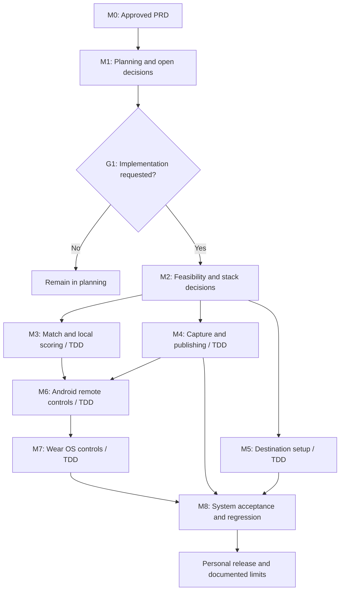

# LiveStream Master Plan

Status: M2 research/preparation and isolated JVM probes in progress; physical/account feasibility pending  
Created: 2026-10-17  
Reorganized into individual task plans: 2026-10-18  
Development method: TDD required; T01–T06 confirmed 2026-10-23; local JVM tools run, final Android/watch tools pending  
Requirements baseline: [Approved PRD](../PRD.md), 2026-10-17  
Design companion: [Software Architecture](../ARCHITECTURE.md)  
Individual task plans: [Subplan index](subplans/README.md)  
Status dashboard: [Current snapshot](STATUS.md) (derived from task records and evidence)  
Progression graph: [Interactive HTML](../.archify/workflow-livestream-progression-20261018-164617/livestream-progression.html)

## 1. Purpose and authority

Deliver a personal Android volleyball broadcasting app with an embedded indoor
scoreboard, automatic quality adaptation, optional YouTube/Twitch sign-in,
manual destination setup, second Android device controls, and Wear OS controls.
This plan translates the approved PRD into work packages, dependencies,
decision gates, and release evidence. The PRD remains the product authority.

The owner requested execution of M2 on 2026-10-23 and explicitly confirmed
T01–T06. G1 is open for M2 feasibility/probe/harness work. On 2026-10-24, ADB
evidence records authorized Pixel 8 Pro and Pixel 10 Pro XL devices and completed
capability inventories; subsequent device-dependent work still requires checking
that the needed phone/watch is currently connected and authorized. Q48 defers
external microphone support/testing until after v1. See the
[execution record](reviews/m2-readiness-and-execution.md).
M3–M8 delivery remains gated by G2 and a further owner request.
No dates, budget, technology selections, or hardware guarantees are implied.

Android Studio is the primary IDE for the whole workspace, including this plan,
the PRD, task plans, evidence, architecture and tools. Open the workspace root
as a general IDE project for repository work; it is not an Android Gradle root.
Open isolated M2 Android Gradle projects separately, as described in the
[Android Studio workflow](../ANDROID_STUDIO.md). This IDE choice does not select
the release application's stack, pass G2, or authorize M3–M8.

| Classification | Meaning |
| --- | --- |
| Confirmed | Requirement or decision already approved in the PRD, or an explicitly identified later owner instruction such as TDD. |
| Proposed | Delivery order, design, or technical approach recommended here. |
| Open | Evidence or a decision is still needed. |
| Completed | An artifact actually exists; this does not mean its recommendations are approved. |

## 2. Confirmed release boundary

| Area | Required first-release outcome |
| --- | --- |
| Destinations | One destination at a time; YouTube and Twitch sign-in with automatic setup; manual URL/key entry for these and compatible services. Sign-in is optional for the operator, but both integrations are in release scope. |
| Capture | Available phone cameras/lenses; built-in microphone, active input/level meter and mute. Q48 defers external wired/Bluetooth microphone support and testing until after version 1. |
| Broadcast | Landscape 16:9 video with the scoreboard encoded into it; stable-connection validation at 720p/30 fps; automatic quality reduction over Wi-Fi and mobile data. Mobile data is the owner-confirmed default; Wi-Fi remains supported. |
| Match | Customizable indoor best-of-5 and best-of-3 presets; points, serve, sets, timeouts, side swaps, undo, corrections, and retained match state. |
| Controllers | Full local controls; second Android phone/tablet; simpler Wear OS interface following PRD section 2.4. |
| Watch connection | Q7 is confirmed: watch paired directly to the streaming phone, using Wear OS Data Layer. Feasibility validation remains necessary. |
| Hardware | One Pixel 8 Pro, two regular Pixel 10 phones, two Pixel 10 Pro phones, and four Pixel Watch 4 watches (one per Pixel 10-series phone). Any device may be tested; main testing uses one Pro, its watch, and the Pixel 8 Pro. Phone roles are interchangeable. Expected software: latest published stable OS version or previous major stable OS version. Actual installed OS/builds and tested compatibility remain unknown. |

Beach volleyball, multiple destinations at once, additional provider sign-in,
local recording, cloud match history, advanced themes, iOS/browser controllers,
automatic score recognition, and tournament management remain outside this
release. Partial milestones are development checkpoints, not a reduced MVP.

## 3. Delivery sequence and gates

The order is proposed for one owner working incrementally. Provider and device
feasibility come early because they can change the implementation approach.
There is no committed calendar estimate before those checks.
M3–M7 deliver behaviors through TDD throughout each milestone. M8 is the final
system acceptance campaign; automated testing begins with the first behavior.

### Diagram: delivery roadmap

[SVG](../docs/diagrams/rendered/delivery-roadmap.svg) ·
[Mermaid source](../docs/diagrams/source/delivery-roadmap.mmd)

| Gate | Evidence needed | Consequence |
| --- | --- | --- |
| G0: Requirements baseline | Approved PRD dated 2026-10-17. | Complete. Explicit TBDs remain open. |
| G1: Implementation authorization | Owner requested M2 execution on 2026-10-23; Q46 records its scope. | Open for M2 feasibility/harness work. It does not pass G2 or authorize later delivery milestones. |
| G2: Feasible design | M2 evidence for media, both providers, Android remote connectivity, direct watch topology, lifecycle, and local persistence; decisions D01–D13 recorded, including the test toolchain and public test boundaries. | Begin relevant implementation packages using TDD; confirm each proposed test boundary with the owner before writing its first test. Resolve any scope change with the owner. |
| G3: Integrated feature coverage | M3–M7 complete, every FR mapped to demonstrable behavior and passing behavioral tests developed test-first, and no first-release feature silently omitted. | Begin final system acceptance with a passing regression suite. |
| G4: Release readiness | M8 evidence passes the PRD targets; supported device/accessory/network combinations and limitations are documented. | Prepare the chosen personal distribution package. A failed required feature keeps the release gate open. |

Gate status after the [M1.1 review](reviews/m1-1-planning-package-review.md)
on 2026-10-18: G0 is complete; G1 has not opened; G2 lacks feasibility and
decision evidence; G3 and G4 have not been reached. Executing M1.1 completes
the documentation review only. The proposed design and open decisions still
need their stated evidence and owner answers.

Current update, 2026-10-23: Q46 opens G1 for M2 execution and Q47 confirms
T01–T06. All eight M2 tasks now have retained research/preparation; two isolated
T02 behaviors passed after observed red results. No physical devices are
available, provider settings are unknown, and G2 remains pending. The earlier
M1.1 gate report above is historical.

## 4. Work breakdown

The owner is responsible for scope and final decisions. A future implementation
agent/developer can execute the technical packages within the authorized scope.
M2 research/local probes are In progress; M3–M8 delivery remains Not started.

### Individual task plans

The owner confirmed one detailed plan per independently verifiable task. The
[subplan index](subplans/README.md) contains 53 individual task plans with
explicit prerequisites, outcomes, steps, acceptance criteria, and evidence to
retain. The breakdown and first behavioral slices are proposed; creating a
plan does not complete its task or open G1. Existing open decisions remain open.

| Milestone | Task plans | Count |
| --- | --- | --- |
| M0 | [Requirements baseline](subplans/README.md#m0-requirements-baseline) | 1 |
| M1 | [Planning package](subplans/README.md#m1-planning-package) | 6 |
| M2 | [Technical feasibility and selection](subplans/README.md#m2-technical-feasibility-and-selection) | 8 |
| M3 | [Match state, persistence, and local controls](subplans/README.md#m3-match-state-persistence-and-local-controls) | 9 |
| M4 | [Capture, overlay, publishing, and adaptation](subplans/README.md#m4-capture-overlay-publishing-and-adaptation) | 7 |
| M5 | [Destination sign-in and automatic setup](subplans/README.md#m5-destination-sign-in-and-automatic-setup) | 4 |
| M6 | [Second Android device and concurrent controls](subplans/README.md#m6-second-android-device-and-concurrent-controls) | 4 |
| M7 | [Wear OS controller](subplans/README.md#m7-wear-os-controller) | 3 |
| M8 | [Acceptance and personal release](subplans/README.md#m8-acceptance-and-personal-release) | 11 |

Skill search, source review, project-scoped installation, and the Grill-me
clarification are recorded in [skill discovery](SKILL_DISCOVERY.md).

### TDD working agreement

The owner's instruction to use TDD applies to future implementation across
M2–M7 and fixes discovered during M8. Follow the installed
[tdd skill](../.agents/skills/tdd/SKILL.md). This is a confirmed development method;
it does not authorize writing application code or tests during planning.

For each behavior, use one small vertical slice:

1. **Specify:** Select a PRD behavior and a public test boundary from the table
   below. Confirm that boundary with the owner before its first test; retain
   that confirmation for subsequent work unless its scope changes. Record a
   concrete input, observable outcome, and acceptance-reference ID.
2. **Red:** Write one focused behavioral test first. Run it and observe failure
   because the behavior is missing or wrong. Resolve harness/build problems
   separately; an infrastructure error is not the intended red result.
3. **Green:** Add only enough application behavior to pass that test. Run the
   affected tests, then take the next behavior through the same sequence.
4. **Review and refactor:** With the relevant suite green, review the slice and
   simplify where useful without changing behavior. Refactoring belongs to this
   review stage, following the skill's red-to-green implementation cycle.
5. **Record:** Retain the test/behavior reference, observed red failure, green
   result, and any outstanding device or real-broadcast evidence. Update the
   requirement mapping as slices become demonstrable.

Do not build a whole component and add tests afterward, or write a large batch
of tests before implementing any of their behaviors. Bug fixes start with one
failing regression test at a confirmed public boundary, then the minimal fix.
Use independently specified expected results, such as known match examples;
avoid reproducing the implementation's calculation in the assertion.

Test observable behavior through public interfaces. Use real project components
together and a real temporary local store when testing persistence. Substitute
only external boundaries such as provider APIs, hardware, network conditions,
and time. Tests must survive changes to private classes, call order, and storage
layout. Add automation where it provides meaningful behavioral evidence;
trivial wiring does not need tests that merely mirror the implementation.

#### Test execution environments

Android Studio Android Virtual Devices (AVDs) are an approved supplementary
environment for applicable automated and exploratory tests, including UI flows,
screen sizes/orientations, selected API-level behavior, lifecycle/permission
handling, and instrumented tests. Choose AVD profiles/API levels to exercise the
eventually selected support matrix; this does not select the release minimum SDK
or production stack. AVD setup is optional for current M2 work unless a specific
authorized experiment needs it.

Keep emulator results separate from host/JVM, physical-device, and received-
broadcast evidence. An emulator cannot establish physical camera/lens support,
microphone routing, sustained hardware encoding or thermal behavior, direct
Pixel Watch pairing, real Wi-Fi/mobile-data handoff, or received platform
broadcast behavior. Required hardware and broadcast checks in V01–V10 remain
required; never claim physical compatibility from an emulator result. Before
device-dependent work, follow the physical connection check in [section 9](#9-next-authorized-work)
and [the Android Studio workflow](../ANDROID_STUDIO.md): verify the needed
phone/watch is connected and authorized, otherwise ask the owner to connect it,
while continuing independent work.

### Proposed public interfaces for tests

The original proposals below were **confirmed by the owner on 2026-10-23**
under Q47. Their scope and stated limits remain the same. D13 records local
JVM tool selection and remaining Android/watch tooling; a boundary change
requires renewed confirmation before its first test.

| ID | Public boundary | Catches through observable behavior | Does not establish |
| --- | --- | --- | --- |
| T01 | Match commands and returned/current snapshots, including reopening a session against the real local store | Scoring rules, undo, corrections, side swaps, accepted revisions, restart recovery, and durable duplicate handling | Physical storage failure modes not exercised by the chosen harness; UI/overlay appearance |
| T02 | Stream/session controls, emitted status, and quality requests at the external media boundary | Readiness failures, confirmed start/stop, retry cancellation, mute-preserving fallback, and adaptation policy using controlled time/feedback | Actual encoder behavior, lens/audio compatibility, thermal endurance, or destination reception |
| T03 | Destination setup operations and their public results, backed by controlled provider responses | Automatic configuration, account selection, authorization errors, renewal, disconnect cleanup, and secret-free results | Actual account eligibility, app review, provider availability, or real authorization/ingest success |
| T04 | Authorized controller protocol into the phone and returned acknowledgments/snapshots | Roles, concurrent ordering, stale/duplicate commands, reconnect/resynchronization, revocation, and equivalent phone/watch command semantics | Bluetooth/Data Layer radio reliability, gym LAN reachability, or real-device response time |
| T05 | Overlay input and rendered output | Required fields, correct committed values, identity-preserving display swaps, and configured layout bounds | Human readability over a court or retention of the overlay in a received platform broadcast |
| T06 | User-visible phone/controller/watch interactions | Intent, deliberate confirmations, enabled/disabled controls, stale/disconnected status, and correct displayed results | Physical watch ergonomics, hardware routing, sustained broadcasts, or platform playback latency |

### TDD definition of done for a behavior

- The behavior maps to a PRD requirement and V01–V10 evidence where applicable.
- Its test boundary was confirmed before writing the test; the relevant test
  was observed red before its implementation or bug fix, then passed.
- The affected regression suite passes, and any review/refactoring preserves
  that result. No test asserts private implementation structure.
- Required device/provider/broadcast checks for the slice are recorded as
  passed or explicitly pending; simulated results never imply hardware support.
- Test commands are documented only after the real toolchain exists. Test
  runners and coverage targets remain TBD; no arbitrary coverage percentage
  substitutes for required behavior and acceptance evidence.

### M0 — Requirements baseline

- **State:** Complete. The approved [PRD](../PRD.md) contains FR-01–FR-06,
  scoring defaults, the device control matrix, success targets, and exclusions.
- **Exit:** Use that baseline without converting its open details into decisions.

### M1 — Planning package

- **State:** M1.1 documentation review complete on 2026-10-18;
  [findings and checks](reviews/m1-1-planning-package-review.md) retained.
  M1.2's [device inventory](inventories/m1-2-device-roles-and-os-inventory.md)
  is complete as of 2026-10-18: interchangeable phone roles, stable OS expectation,
  five phones, four owner-reported watch pairings, the main test group, and
  explicit installed-software unknowns recorded.
  M1.3's [microphone inventory](inventories/m1-3-representative-audio-accessories.md)
  is complete as of 2026-10-18: the owner has built-in inputs available now;
  USB, other wired, receiver, and Bluetooth cases remain pending for later
  physical checks. M1.4's [upload inventory](inventories/m1-4-venue-upload-baseline.md)
  is complete as of 2026-10-18 on its checklist's explicit-evidence-gap path:
  the owner selected mobile data as the default because venues change.
  Wi-Fi remains supported; upload measurements remain unknown.
  M1.5's [worked specification](specifications/m1-5-match-correction-specification.md)
  is complete as of 2026-10-18, with 36 examples and three owner decisions:
  point removal preserves serve, conflicting historical corrections are rejected,
  and one-step Undo remains available after restart. M1.6's
  [scoreboard specification](specifications/m1-6-overlay-display-specification.md)
  is complete as of 2026-10-18, with 16 examples, static artwork, and owner-confirmed
  placement presets, 1–5-character validated codes, and numeric `T/O` counts.
  All six M1 documentation tasks are complete. Remaining D10/D11 details,
  technical selections, and physical/received-broadcast evidence remain open.
  The 2026-10-20 D11 follow-up adds four confirmed choices under PRD Q22–Q25:
  preserve the margin at a cap conflict, allow totals-only starting baselines,
  pause ordinary rally input at a potential winner, and require confirmed
  current-set continuation before scoring beyond the cap. The 2026-10-21
  follow-up adds Q26/Q27: the full listed match-edit Undo scope/consumed repeat
  behavior and watch Undo authority, plus Q28: completed-match entry only from
  complete ordered valid history. Q29 now settles initial/restored cap-input
  validation, and Q30 confirms conditional reopening after a valid completed-match
  correction. Q31/Q32 now confirm matching early-history replacement without
  double counting and valid reviewed baseline corrections after later play.
  Q33–Q35 confirm explicit first-server selection, retained reset fields,
  and confirmed reset on phones/tablets only.
  Q36 allocates cap-continuation confirmation and Undo of its latest confirmation
  to permitted phones/tablets; the watch directs both actions to a phone.
  Other D11 details remain open; task counts do not change.
- **Deliverables:** This plan, [architecture](../ARCHITECTURE.md), Mermaid source,
  rendered SVGs, decision register, requirement mapping, TDD working agreement,
  proposed public test boundaries, and validation plan.
- **Remaining work:** Gather per-session upload observations as venues change,
  prioritizing mobile data and retaining Wi-Fi cases; identify actual accessories
  when available for the pending physical checks; record installed OS/builds; resolve
  decisions that can be settled from documentation.
- **Exit:** Reviewable design and implementation backlog; no application scaffold.

### M2 — Technical feasibility and selection

**State:** All eight tasks In progress as of 2026-10-23. The
[execution record](reviews/m2-readiness-and-execution.md) links research,
candidate comparisons, validation procedures and the isolated JVM TDD harness.
T01–T06 are confirmed. Two T02 behaviors and six T01 host SQLite cases passed
after observed failures: file reopen/retry, point-write interruption, concurrent
distinct commands, durable reset generation, late old-command rejection and
receipts scoped to generation. Simultaneous duplicate delivery, canceled reset
and before-commit reset interruption passed on their first runs with the existing
store implementation. [ST03 post-commit interruption](evidence/m2/st03-lost-acknowledgment.md)
also passes on its first run on 2026-10-24, preserving the original receipt and
newer current state across retries. The current local suite has twelve passing tests and
eight observed red/green cycles; it establishes no Android or power-loss
recovery guarantee. [ST05 evidence](evidence/m2/st05-reset-isolation.md) keeps
the probe's file-local epoch distinct from the final application identity scheme.
The owner now reports devices available but not connected; registrations are
reported to exist but their nonsecret settings are unknown. Required physical/media/account/upload
evidence and final decisions remain missing. No M2 task or G2 is marked complete.

**Depends on:** G1 and M1. Plan the checks now; execute prototypes only after G1.
G1 is now open for M2; M1 is complete. Task completion dependencies remain in
force. Local runner preparation does not pass M2.7's missing feasibility inputs.
Define each feasibility scenario and its expected evidence before running it.
Unknown hardware/provider capabilities require exploratory measurements;
repeatable application behavior in a prototype follows the same TDD agreement.
Disposable probes are not promoted into production without test-first behavior
at a confirmed boundary and the appropriate physical/provider checks.

| Package | Investigation and evidence | Exit condition |
| --- | --- | --- |
| M2.1 Device inventory | Record OS/builds, intended phone roles, exposed lenses, encoder capabilities, available microphone routes, and watch companion pairing. | Hardware matrix exists with tested, untested, and unavailable states. |
| M2.2 Media feasibility | Evaluate capture-to-compositor-to-encoder integration, embedded scoreboard, live lens changes, route changes, audio/video timing, dynamic bitrate, and sustained thermal load. | Candidate pipeline demonstrates the required path and documents interruptions and unsupported changes. |
| M2.3 Provider feasibility | Check app registration, account eligibility, authorization/scopes, token renewal, ingest details, and YouTube broadcast selection/creation/binding. Evaluate Twitch public-client authorization without embedding a client secret. | A viable path is documented for **each** sign-in integration and for manual setup; review/quota dependencies are explicit. |
| M2.4 Remote feasibility | Evaluate second-device LAN/hotspot connectivity and alternatives, gym client isolation, mobile uplink coexistence, authentication, acknowledgments, and reconnects. Check Data Layer between the watch and its directly paired streaming phone. | Supported topology is demonstrated on the selected devices; transport choice and limitations are recorded. |
| M2.5 Lifecycle and recovery | Evaluate permissions, foreground capture, screen dimming/lock, backgrounding, incoming calls, audio loss, persistence atomicity, and process recreation. | Allowed behavior and failure recovery are defined for the selected OS versions. |
| M2.6 Quality policy | Measure upload conditions; choose bitrate bounds, observation windows, downgrade thresholds, recovery hysteresis, reconnect limits, and handoff behavior. | D07 contains measurable parameters and controlled Wi-Fi/mobile test scenarios. |
| M2.7 Stack decision | Compare maintainability, licenses, supported APIs, direct surface integration, device evidence, and small-project effort; consolidate M1 specifications and M2 findings for G2. | D01–D12 have recorded evidence and decisions, or explicit blockers; M2.8 completes the D13 handoff. No choice is inferred from installing a skill. |
| M2.8 TDD preparation | Select language-compatible test runners and device/instrumentation support; document public test boundaries, their limits, fixtures, controlled time/network/provider inputs, optional AVD use, and owner confirmation. | D13 records tools and confirmed boundaries; after G1, establish a runnable harness and use red-to-green for the first application behavior. Keep emulator and physical evidence distinct; AVD coverage does not replace required hardware checks. |

A blocker in provider setup or hardware support is surfaced at G2. Manual
destination setup is useful during development, but it does not satisfy the
approved automatic-setup feature by itself.

### M3 — Match state, persistence, and streaming-phone controls

**Depends on:** G2 for language/storage choices; scoring specifications can be
reviewed during M1. Covers FR-04 and FR-05.

**TDD entry:** T01/T06. After minimal match setup, prove that a rally point for
the receiving team increases that team's points and transfers serve. Complete that red-to-green
slice before adding scoring variants, undo, persistence, and corrections one
behavior at a time. Then use T05 for the shared scoreboard presentation.

- Implement stable team identities, an independent display order, a per-match
  configuration copied from a preset, completed-set history, and derived totals.
- Implement sideout serving, nonnegative points/timeouts, best-of-5/best-of-3,
  custom targets/margin/cap/timeouts, explicit set/match confirmation, and reset
  confirmation. Final-set confirmation retains the final points.
- Support team/abbreviation edits, starting values, undo, historical corrections,
  and recomputation of related totals without corrupting later sets.
- Persist every accepted match edit atomically with revision/deduplication data;
  restore the latest committed match after restart.
- Expose the phone controls and a shared overlay model containing abbreviations,
  points, sets won, timeouts remaining, serving team, and display order.
- **Exit:** Domain scenarios and restart recovery pass; the local UI and overlay
  model agree after edits, undo, side swaps, and historical corrections.

### M4 — Capture, overlay, manual publishing, and adaptation

**Depends on:** M2 media/lifecycle/quality decisions; integrate M3 before exit.
Covers FR-01–FR-04.

**TDD entry:** T02/T05/T06. Begin session-control behavior with a confirmed
start being rejected when capture is not ready; add lifecycle, overlay, input fallback, publishing, and
quality behaviors in separate red-to-green slices. Real media checks accompany
the relevant slices. Adaptation expectations await D07 instead of guessed values.

- Discover supported lenses and inputs; implement preview, input selection,
  level meter, mute, route fallback, and documented switching behavior.
- Composite the scoreboard into outgoing landscape video before encoding;
  preserve the same match values in preview. Validate legibility at 720p.
- Add manual URL/key entry, masking, protected storage, one publisher, and
  explicit preparing/connecting/streaming/reconnecting/stopped/error states.
- Implement confirmed start/stop, bounded recovery, automatic quality reduction,
  measured recovery behavior, and Wi-Fi/mobile-data handoff policy from D07.
- Add capture status, low-power screen mode, actionable errors, and sanitized
  diagnostics that cannot expose stream keys or tokens.
- **Exit:** A real destination receives video, audio, and all required overlay
  fields; degradation and input changes preserve match state. Full-duration
  acceptance remains M8.

### M5 — Optional destination sign-in and automatic setup

**Depends on:** M2 provider feasibility; M4 is required for broadcast validation.
Covers FR-01 and the local-only credential controls in FR-06.

**TDD entry:** T03/T06. First prove successful setup returns the chosen account
and a ready configuration without going live. Add provider-specific errors,
renewal, and disconnect cases one at a time, with real authorization/ingest
checks after the controlled cases pass.

- Add YouTube authorization, account/channel selection, broadcast selection or
  creation as needed, stream binding, and automatic ingest configuration.
- Add Twitch authorization, authorized stream-key retrieval, and ingest selection.
- Keep provider adapters separate from manual destination entry. Show the chosen
  account/channel and broadcast before confirmed start; sign-in never starts it.
- Handle cancellation, expiry, revocation, missing scopes, eligibility, quota,
  refresh failure, changing accounts, and disconnect/removal of saved authorization.
- **Exit:** Each integration independently completes setup and a test broadcast
  with no manual URL/key retrieval; manual mode still works without sign-in.

### M6 — Second Android device and concurrent controls

**Depends on:** M3, the M4 session-control interface, and M2 transport/security.
Covers FR-06 across the complete phone/tablet control matrix.

**TDD entry:** T04 with T01/T02/T06 as needed. First send the same score-command
ID twice and prove the accepted score changes once. Add ordering, stale edits,
reconnect, revocation, and confirmed media operations through subsequent slices.

- Add deliberate pairing, controller authorization and revocation, connection
  status, current-state snapshots, and only the permitted controller capabilities.
- Route local and remote commands through one accepted order on the streaming
  phone. Use unique command IDs, explicit results, revision checks, and durable
  duplicate handling so retries cannot score twice.
- Require resynchronization before edits after reconnect. Reject stale or
  expired actions; avoid silently replaying disconnected score taps.
- Include remote camera choice, microphone mute, and confirmed start/stop when
  the streaming phone is capture-ready; keep credentials and account management
  on the streaming phone.
- **Exit:** Concurrent local/mobile commands, duplicate delivery, reconnect,
  revocation, and interrupted connections preserve a consistent state. Local
  scoring and publishing continue after controller loss.

### M7 — Wear OS controller

**Depends on:** M6 command contract and M2 direct-pairing evidence.
Covers the approved watch portion of FR-06; it is a required release package.

**TDD entry:** T04/T06. First prove a disconnected watch cannot submit an edit
until it receives a fresh snapshot. Add each permitted action and restricted
control through a focused red-to-green slice, then exercise it on Pixel Watch 4.

- Reuse match commands and sanitized status over Data Layer to the directly
  paired streaming phone. Apply application authorization in addition to pairing.
- Provide readable scores/status, add/remove points, undo, serve toggle,
  timeout correction, set confirmation, side swap, mute, and confirmed start/stop.
- Keep team names/history/presets view-only; defer watch camera selection and
  exclude credential/account/controller administration as in PRD section 2.4.
- Show disconnected/stale state and require a fresh authoritative snapshot before
  edits. Measure interaction effort and response on Pixel Watch 4.
- **Exit:** Every approved watch control works on the physical pairing; phone,
  second Android device, and watch participate in the same session.

### M8 — Acceptance, supported configurations, and personal release

**Depends on:** G3. Covers all requirements together, rather than isolated demos.
Enter with M3–M7 behavioral tests already passing. M8 adds full-system and
physical acceptance evidence. Every reproducible application defect found here
returns to a failing regression test before its fix; device-only findings also
retain a repeatable physical validation scenario.

- Execute the evidence matrix below, investigate failures, and repeat only the
  affected checks after fixes.
- Record device/OS, accessories, connection, destination, quality, duration,
  observed interruptions, latency evidence, and sanitized diagnostics.
- Document setup, pairing, account disconnect, recovery steps, supported
  combinations, known limits, and the selected distribution/update workflow.
- **Exit:** G4 evidence passes. No emulator result is presented as proof of
  physical camera, microphone, Bluetooth, watch, or thermal compatibility.

## 5. Requirement-to-delivery traceability

| PRD requirement | Implementation packages | Architecture responsibility | Acceptance evidence |
| --- | --- | --- | --- |
| FR-01 Destinations and adaptive publishing | M2.2–M2.3, M2.6, M4, M5 | Session coordinator, destination adapters, publisher, quality controller, credential store | V01, V02, V05, V08, V09 |
| FR-02 Cameras/lenses | M2.1–M2.2, M4 | Capability discovery and camera adapter | V04, V08 |
| FR-03 Microphones | M2.1–M2.2, M4 | Audio routing/capture and mute control | V04, V08 |
| FR-04 Broadcast scoreboard | M3, M4 | Match projection, compositor, controller snapshots | V02, V03, V07 |
| FR-05 Match edits and retention | M3 | Command processor, rules engine, atomic local persistence | V03, V06, V07 |
| FR-06 Android and Wear OS controls | M2.4, M6, M7 | Controller adapters, authorization, ordered commands, resynchronization | V06, V07, V10 |
| PRD 4.2 Lifecycle and sustained operation | M2.5, M4, M8 | Capture lifecycle and device-health handling | V01, V04, V08 |
| PRD 4.3 Security and privacy | M2.3–M2.5, M4–M7 | Protected credentials, capability checks, sanitized diagnostics | V05, V06, V09, V10 |

## 6. Validation and evidence plan

These are future validation activities, not tests already run. PRD thresholds
are retained exactly where specified; proposed scenarios add coverage without
claiming new approved performance targets.

| ID | Scenario | Required evidence / pass condition | Basis |
| --- | --- | --- | --- |
| V01 | Sustained real broadcasting | 60-minute smoke test and a 90–120 minute full-match session to YouTube and a separate session to Twitch, at 720p/30 fps on the chosen test phone and stable upload; no crash or unrequested stop. Record thermal/battery behavior and dimming. | PRD success target; extend across intended streaming-phone roles before claiming them supported. |
| V02 | Received overlay | All 20 scripted name/score/set/timeout changes appear correctly in the received stream for the indoor preset; also verify a customized format, abbreviations, serve, display order, landscape, and 720p readability. | PRD success target and FR-04. |
| V03 | Scoring integrity | Best-of-5/best-of-3, deuce, deciding set, custom cap/margin/timeout counts, sideout, point subtraction versus undo, explicit confirmations, reset, and corrections to completed sets. | PRD FR-05 and presets. |
| V04 | Lens/audio continuity | Enumerate exposed lenses; exercise supported live switches and built-in audio/level/mute, match retention and no crash. Q48 defers USB/wired/receiver/Bluetooth support and connection/disconnection validation until after version 1. | PRD input-continuity target and Q48; physical hardware required for v1 built-in capture. |
| V05 | Signed-in and manual setup | A test broadcast through each sign-in integration without manually obtaining/entering URL/key; correct account/channel preview, no automatic go-live on sign-in, usable manual setup without login. | PRD success target and FR-01. |
| V06 | Command delivery and recovery | Lost acknowledgments, duplicates, concurrent controllers, stale revisions, reconnect snapshots, revocation, and phone process recreation; each accepted edit applied once and restored durably. Local scoring/publishing survive controller loss. | PRD FR-05/FR-06; fault scenarios proposed. |
| V07 | Remote response | At least 95% of 50 acknowledged remote score changes reach the phone and outgoing overlay within 2 seconds on the supported connection; log tap/send, commit, acknowledgment, and overlay timestamps. Measure viewer playback separately. Exercise both mobile and watch paths. | PRD target; per-path sampling proposed for diagnosis. |
| V08 | Network/lifecycle stress | Controlled upload restrictions on Wi-Fi and mobile data cause automatic reduction without losing match/overlay state. Exercise handoff, outage/retry exhaustion, screen lock/backgrounding, permission loss, call/audio interruption, and thermal limits. | Quality reduction and continuity required; numeric adaptation/handoff criteria await D07/D08. |
| V09 | Credential boundary | Masking, sanitized errors/logs, protected storage, canceled/revoked/expired authorization, least scopes, account switching, disconnect deletion, and absence of destination secrets in controller payloads. | PRD FR-01 and 4.3. |
| V10 | Full controller matrix | Demonstrate every allowed control and deny restricted controls on the streaming phone, Android remote, and directly paired Pixel Watch 4; confirm remote start/stop and reset, and readiness failures. | PRD 2.4 and FR-06. |

Automated behavioral tests drive implementation throughout M2–M7 under the TDD
working agreement in section 4. V01–V10 specify acceptance evidence collected
alongside relevant slices and completed at M8; they are not a later phase for
adding the first tests. Real broadcast observation and physical devices remain
required. The original documentation phase had no application tests. The later
authorized isolated M2 runner has actual commands/results in
[M2.8](specifications/m2-8-tdd-tooling-and-boundaries.md); no physical or full
application acceptance result is inferred from it.

## 7. Open decision register

All aggregate entries are **open**. Q47 has settled T01–T06 confirmation and
the local JVM tools run; D13 still needs the final Android/watch handoff.
Recommendations remain evaluation proposals unless explicitly selected.
Architectural details and official references are in
[architecture section 11](../ARCHITECTURE.md#11-technology-and-decision-register).

G2 requires a recorded disposition for every D01–D13 decision, with required
choices resolved and evidence present before the gate passes. Milestones after
G2 in the last column identify where a decision is applied or validated; they
do not defer its initial resolution. M2.7 consolidates D01–D12 from the M1
specifications and M2 investigations; M2.8 records D13. Any unresolved required
choice keeps G2 open. TDD boundary confirmation is required before the first
test at that boundary, including any earlier M2 feasibility behavior.

The [2026-10-20 focused D11 review](specifications/m1-5-match-correction-specification.md#focused-d11-policy-review-2026-10-20)
prepares concrete owner choices and twelve additional written cases. Answers on
hard-cap precedence, mid-match baseline totals, and potential-winner rally input
are now recorded as Q22–Q24: preserve the winning margin, allow baseline totals,
and pause rally scoring until confirmation or correction. Q25 adds confirmed
current-set continuation beyond the cap. Q26/Q27 now confirm Undo scope/repeat
  behavior and watch authority; Q28 confirms completed-match entry; Q29 confirms
  initial/restored cap-input validation; Q30 confirms correction review and
  conditional reopening; and Q31/Q32 confirm baseline/history reconciliation.
  Q33–Q35 confirm first-server selection, reset contents, and reset authority.
  Q36 confirms phone/tablet-only cap-continuation confirmation and its latest
  Undo; technical mechanisms/retention remain open. M1.5 stays complete
for its documentation scope; no application task or gate is advanced by this review.

The [2026-10-21 Undo/watch review](specifications/d11-undo-and-watch-policy-review.md)
records the confirmed Q26/Q27 coverage matrix and U01–U12 for cross-device
permissions, consumed Undo after restart, set/match confirmation, cap continuation,
stale requests, media independence, and duplicate-command recovery. The selected
policy limits watch Undo to its allowed controls and forbids skipping a restricted
latest edit. M1.5 remains complete for documentation; no gate advances.

| ID | Decision / evidence needed | Recommended planning direction | Needed by |
| --- | --- | --- | --- |
| D01 | Installed OS versions, phone roles, representative microphones, venue uploads | Inventory the actual devices and measure both available uplinks; keep unknowns explicit. | M2 entry inputs; resolved by G2 |
| D02 | Language, UI toolkit, minimum/target Android versions | Evaluate a native Kotlin/Compose approach against maintenance effort and measured API needs. | G2 |
| D03 | Camera, audio, compositor, encoder, publisher/library | Prefer one coherent pipeline with direct overlay composition and tested live bitrate control; compare CameraX/Camera2 integration rather than assuming either. | G2 |
| D04 | Local persistence and command receipts | Evaluate transactional SQLite/Room versus an atomic serialized store; require crash-consistent state plus deduplication. | G2 / M3 |
| D05 | Second Android transport and pairing | Evaluate authenticated nearby LAN/hotspot first; verify client isolation and simultaneous internet uplink. | G2 / M6 |
| D06 | Provider registration, scopes, auth/refresh, quotas/review | Resolve YouTube and Twitch independently with mobile-safe flows. Do not assume one generic OAuth flow fits both. | G2 / M5 |
| D07 | Quality bounds, timing, recovery, handoff, reconnect limits | Evaluate bitrate-first adaptation with hysteresis; add resolution/fps changes only if pipeline/provider continuity is demonstrated. | G2 / M4 |
| D08 | Capture lifecycle, screen dimming/lock, interruptions, thermal behavior | Explicit foreground-capture readiness and visible recovery; define supported OS behavior with physical evidence. | G2 / M4 |
| D09 | Wear UI/framework, signing, direct-pairing evidence | Keep confirmed Q7; validate Data Layer reachability, same app identity/signature, and owner pairing steps. | G2 / M7 |
| D10 | Technical preference/recovery/confirmation/stop contracts, safe area, numeric capacity, type/fit, quality-floor readability | Confirmed Q19–Q21/Q37–Q45: placement/Undo, code validation/duplicates/recovery, numeric `T/O`, adaptive numeric layout, and a visible stop preserving the full new match/off-air scoring when numbers cannot fit. Resolve technical contracts, numeric capacity, geometry, fit, contrast, and received-video legibility using M1.6. | G2 / M3 / M4 |
| D11 | Reconciliation/identity/revision mechanisms, protocol retention | Confirmed: point removal preserves serve; reject conflicting history; Q18/Q26/Q27 define durable one-step Undo and watch authority; Q22/Q25/Q29 define cap behavior; Q23/Q28/Q30–Q32 define entry/history/reopening; Q24 pauses rally input at a potential winner; Q33 requires explicit first-server selection; Q34/Q35 define retained reset fields and phone/tablet-only authority; Q36 permits continuation confirmation and Undo of that latest confirmation on permitted phones/tablets only. Resolve revision-bound atomic operations, reset identity, expiry, and receipts using M1.5. | G2 / M3 / M6 |
| D12 | Distribution/update method, provider deployment credentials, validation coverage | Choose the simplest personal distribution path that preserves phone/watch signing compatibility and provider configuration. | G2 / M8 |
| D13 | Final Android/watch test tools and harness evidence; boundary confirmation settled | Q47 confirms T01–T06. Local Kotlin/JDK/Gradle/JUnit runner and eight T01/T02 red/green cycles are retained in M2.8. Include suitable AVD profiles/runners as optional supplementary coverage where useful; complete the final stack/instrumentation/storage-failure handoff before G2 and keep AVD evidence distinct from physical-device evidence. Preserve confirmed boundaries unless their scope changes. | G2 via M2.8 / before first test at a changed boundary |

D06/D12 research began on 2026-10-20. The
[M2.3 findings](specifications/m2-3-provider-setup-feasibility.md)
recommend evaluating Google's Android authorization and Twitch's Public device
grant independently. Actual registrations, account eligibility, scope and
distribution choices, Twitch refresh lifetime/suitability, endpoint compatibility,
and active-stream switch/disconnect policy remain open. All D01–D13 records
remain unresolved; no backend, library, or provider configuration is selected.

D01 evidence started on 2026-10-18 in the
[completed M1.2 inventory](inventories/m1-2-device-roles-and-os-inventory.md).
The owner confirmed interchangeable phone roles, expected current/previous major
stable OS versions, and a separate Pixel Watch 4 paired with each of the four
Pixel 10-series phones (two regular and two Pro). Main testing uses one Pro,
its watch, and the Pixel 8 Pro; any available device may be used.
Actual installed OS/builds remain explicitly unknown. Q7's direct pairing
requirement is unchanged; D01 remains open for device observations, accessory,
network, and capability evidence. M1.2 completion does not close D01 or pass G2.

M1.3's [completed microphone inventory](inventories/m1-3-representative-audio-accessories.md)
records the owner's 2026-10-18 answer: built-in microphones only for now.
The USB, other wired, receiver, and Bluetooth validation cases are documented
with equipment pending. This satisfies the planning task's treatment of
unavailable combinations; actual accessory selection, exposed input routes,
and physical/received-audio evidence remain open under D01 and later validation.
Q48 subsequently defers external microphone support/testing until after v1;
built-in audio remains the M2/version 1 validation path.

M1.4's [completed upload inventory](inventories/m1-4-venue-upload-baseline.md)
records N01/N02 Wi-Fi/mobile measurement gaps, proposed collection fields,
and the M2.6 handoff. The owner has no venue-specific measurements because
venues keep changing and selected mobile data as the default broadcast
connection; Wi-Fi remains supported. No venue upload test or handoff check has run. This
satisfies M1.4's allowance for explicit gaps and completes its documentation
prerequisite for M2.6; D01/D07 still need measured inputs, media evidence,
and recorded policy decisions before G2 can pass. The stable-connection
validation baseline remains 720p/30 fps, with no numeric quality policy selected.
How to honor the mobile-data default when Wi-Fi is connected remains part of
M2.6/D07's routing design, alongside handoff/fallback and measured quality policy.

M1.5's [completed planning specification](specifications/m1-5-match-correction-specification.md)
records the owner's three 2026-10-18 answers under PRD Q16–Q18. D11 remains
open for the other listed policies and implementation mechanics. The four
2026-10-20 follow-up answers are Q22–Q25; the 2026-10-21 answers are Q26–Q36.
Its 36 original, twelve supplemental, twelve Undo/watch, seven completed-entry,
nine cap-input, six reopening, twelve baseline/history, fourteen serve/reset,
and ten cap-permission examples apply
the confirmed scoring, correction, and Undo policies while retaining remaining
technical mechanisms as open. These are not application
or automated-test results. M1.5 completion satisfies its documentation
prerequisite for M3.1/M3.6, whose G1/G2, decisions, and test-boundary conditions
still apply.

M1.6's [completed scoreboard specification](specifications/m1-6-overlay-display-specification.md)
records the owner's original answers under PRD Q19–Q21. The static SVG/PNG demonstrates
top-left and bottom-center examples of configurable placement, with 16 written
cases and review criteria. The [placement/control review](specifications/d10-placement-control-policy-review.md)
adds Q37–Q39 and PL01–PL10, confirming the initial default, per-phone retention,
and phone/tablet-only placement changes before/during a live stream. Q40 adds
placement's exclusion from match Undo, with PU01–PU08 covering preservation of
its current opportunity and position during match restoration.
The [abbreviation-validation review](specifications/d10-abbreviation-validation-policy-review.md)
adds Q41/Q42 and AV01–AV11: prepared uppercase A–Z/digit codes, with matching
codes allowed after warning and explicit confirmation; stable identities stay separate.
D10 stays open for technical contracts, remaining visual rules, and real
readability evidence. The documentation prerequisite for M3.9 is satisfied;
its other dependencies, G1/G2, and test-boundary confirmation still apply.

If a decision changes confirmed scope, update the PRD only after the owner's
answer. This plan and architecture do not silently reopen Q1–Q36.

## 8. Risk response and sequencing

| Risk | Earliest reduction | If unresolved |
| --- | --- | --- |
| Lens or accessory routing unavailable | M2.1–M2.2 physical inventory | Document exposed capabilities; resolve any required scope change before claiming support. |
| Provider auth/review blocks automatic setup | M2.3 for both providers | Track as a release blocker; manual mode remains usable but does not replace M5. |
| Gym network blocks controllers or lacks upload | M2.4 and M2.6 | Evaluate hotspot/transport alternative and quality floor; make disconnection/recovery visible. |
| Heat, battery, audio drift, or compositor load | M2.2/M2.5, then V01 | Adjust quality/processing and validate again on the chosen phone; retain match data through failure. |
| Duplicate commands or partial persistence | M3/M6 command contract | Commit match plus receipt atomically and resynchronize controllers. |
| Watch paired to a different phone | M2.4/M2.1 | Explain the direct-pairing prerequisite; do not add a relay topology without owner agreement. |
| Scope becomes too large for one owner | Small vertical milestones, early feasibility | Reprioritize development order; changing first-release requirements needs an explicit scope decision. |

## 9. Next authorized work

Current focus is completing M2 under Q46. The
[execution/readiness record](reviews/m2-readiness-and-execution.md) links the
work for all eight tasks, actual JVM red/green evidence and the remaining
physical/account handoff. The owner confirmed T01–T06 under Q47. G1 is open
for M2; G2 has not passed.

The latest local continuation verifies [ST03 lost acknowledgment](evidence/m2/st03-lost-acknowledgment.md)
after the earlier ST02/ST04/ST05 checks. A child JVM halts after commit before
returning its receipt; retries recover the original result without applying
another point or replacing newer state. Twelve local tests are green, with
eight observed red/green cycles and four first-run verifications. Recommended
next independent host work is to specify ST06's durable pending-stop contract
and interruption checkpoints at T01/T02 before an isolated TDD experiment.
Q45's policy is confirmed; final stop/recovery mechanisms remain D10 proposals.
These host probes do not waive remaining physical/account or application-storage evidence.

On 2026-10-24, [ADB and the capability APK](evidence/m2/phone-capabilities-2026-10-24.md)
observed authorized Pixel 8 Pro and Pixel 10 Pro XL connections, both on Android
17/API 37, followed by permission-granted camera/codec/audio inventories. The
paired watch is owner-reported available; actual media/watch paths and provider
settings remain unverified. Q48 defers external microphone
support/testing until after version 1. Built-in audio and the remaining device,
network and provider checks are still required. When connected/configured, follow
C01–C06, MP01–MP07, P01–P12, RT01–RT07, ST01–ST07 and AQ01–AQ08, recording
actual builds, routes, received output and failure observations.

Before any development, debugging, or validation that requires a physical
Android phone, check whether the required phone is connected and authorized in
ADB/Android Studio. If it is not, ask the owner to connect or authorize the
specific required phone before proceeding with that device-dependent work.
Identify the needed role/model and connection action; do not imply a device test
was performed without evidence. Continue independent host-side, research, and
documentation tasks while awaiting connection. Apply the same check to a watch
for physical Wear OS work. See the [Android Studio workflow](../ANDROID_STUDIO.md)
for IDE/project boundaries and the connection procedure.

The [D01–D13 ledger](specifications/m2-7-stack-and-decision-dispositions.md)
keeps the proposed application stack distinct from selected local tools.
Resolve remaining geometry/numeric capacity and Q45 stop/recovery mechanisms
alongside media/quality evidence; complete final Android/watch tooling and
required owner decisions before G2 review. M3–M8 delivery and any external
account changes/publication require their own applicable authorization.
